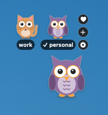

# Claude Pet 🦉

A little pet that lives on your Mac desktop and switches between your personal and work Claude accounts in a click.



A free, just-for-fun project from [GeekyOwls](https://geekyowls.com). It's for macOS and isn't affiliated with Anthropic.

## How it works

You log in to each Claude account once, the normal way. Claude Pet keeps a copy of each login on your Mac as a **profile**, and switching swaps the right one back in:

- **Claude Code:** swaps the saved login. Running `claude` sessions keep the old account until you restart them.
- **Claude desktop app:** if it's open, Claude Pet quits it, swaps in the other profile's data and reopens it. This takes a few seconds.

Before switching away from a profile, Claude Pet saves its latest login, so tokens that refreshed in the meantime aren't lost. Everything stays on your Mac.

Profiles are for accounts with **different emails**. If your personal and work accounts share one email, claude.ai and the desktop app can already switch from your name in the bottom-left corner.

claude.ai in Chrome isn't switched by the pet. Claude Pet for Chrome is coming soon.

## Install

You need a Mac and Apple's command line tools, which the pet is built with. If you don't have them, run `xcode-select --install` first.

### One line in Terminal

```
claude plugin marketplace add geekyowlshq/claude-pet && claude plugin install claude-pet@geekyowls && "$(ls -d ~/.claude/plugins/cache/geekyowls/claude-pet/*/ | tail -1)bin/claude-pet" install-pet
```

This adds the GeekyOwls marketplace, installs the plugin and builds the pet. Click the pet to name your first profile.

### From Claude Code

The same three commands work in the **Code tab of the Claude desktop app** and in **`claude` in Terminal**:

```
/plugin marketplace add geekyowlshq/claude-pet
/plugin install claude-pet@geekyowls
/claude-pet:setup personal
```

`setup` builds the pet, puts it on your desktop and saves the account you're logged into now as the profile `personal` (use any name up to 10 characters).

Then add your other account:

```
/claude-pet:add work
```

Claude Code and the desktop app sign out. Log in to your work account in each once, and you're done.

| Command | What it does |
| --- | --- |
| `/claude-pet:setup [name]` | Build the pet and save your current account as a profile |
| `/claude-pet:add <name>` | Add another profile |
| `/claude-pet:switch [name]` | Switch to that profile, or the next one. You can also just ask "switch to my work account" |
| `/claude-pet:list` | Show your profiles |
| `/claude-pet:remove <name>` | Delete a profile |

### Update

The pet tells you when a new version is out (a bubble, and a red dot on ⚙︎) and updates itself in one click. You can also check under Settings → About, turn on **Install updates automatically** there, or update from Terminal:

```
claude-pet self-update
```

Your profiles and settings are kept.

### Without Claude Code

Download this repo and run `./install.sh`. You get the same pet, plus a `claude-pet` command in `~/.local/bin` (`claude-pet --help`).

## Using the pet

- **Hover** the pet: one small pet pops out per profile, with its name. Hover a small pet to see its email; **click** one to switch to it. The active profile has a ✓ and sits next to three buttons: **♥** (support the developer), **+** (add a profile) and **⚙︎** (Settings).
- **Settings** (⚙︎, or right-click the pet → Settings…):
  - **Profiles:** your profiles as cards, ✓ next to the one in use and × to delete one. Click one to rename it, switch to it or give it its own pet (owl, dog, cat, fox or penguin) in one of five colours. Two profiles can be the same animal in different colours.
  - **Pet:** the pet's size (Tiny to Huge) and whether Claude Pet starts when you log in.
  - **Switching:** which apps switch, and whether to ask before restarting the desktop app.
  - **About:** version and links.
- **Drag** the pet anywhere. Near the top of the screen the profiles open below it; against a side they open as a column.
- When a switch finishes, the pet cheers (owls and penguins flap, dogs, cats and foxes wag their tails) and a small speech bubble says what happened, like "✓ Switched to work · Restart running claude sessions". Errors show up there too; click a bubble to dismiss it.

Emails come from Claude Code's login, or from the desktop app once you've used a profile there. They're saved with the profile.

## Troubleshooting

- **"Please run /login" or an expired login in Claude Code.** Log in again with `/login`. Claude Pet saves the new login when you next switch away. If a running `claude` session still shows the old account, exit and start `claude` again.
- **macOS asks whether "Claude Pet" may control "Claude".** Click **Allow**. That's how the pet quits and reopens the desktop app. If you clicked Don't Allow, turn it back on in System Settings → Privacy & Security → Automation → Claude Pet → Claude.
- **Setup says the command line tools are missing** (or `swiftc` isn't found). Run `xcode-select --install`, wait for it to finish, then run `/claude-pet:setup` again.
- **The desktop app didn't quit.** Close it yourself and switch again. A chat or Cowork task that's running blocks quitting.
- **The pet disappeared.** It may have quit: open "Claude Pet" from ~/Applications. If it's off screen, relaunch it and it comes back into view.
- **Windows or Linux.** Not yet. Claude Pet is macOS only for now.

## Where your logins live

Everything stays on your Mac, and nothing is sent anywhere:

- **Claude Code logins:** your macOS Keychain, as items named "ClaudePet cli: <profile>".
- **Desktop app data, pet and email per profile:** ~/Library/Application Support/ClaudePet/profiles/<profile>.
- **The pet's settings** (position, size, which apps switch): the Claude Pet app's preferences.

## Good to know

- Claude Pet works by moving the files where Claude apps keep their logins. If an app update changes where that is, that part may stop working until Claude Pet is updated.
- Switching the desktop app closes it, so any chat or Cowork task running there stops. Claude Pet asks first (you can turn that off).

## Uninstall

Quit the pet (right-click it → Quit Claude Pet), then delete "Claude Pet.app" from ~/Applications, delete ~/Library/Application Support/ClaudePet and ~/.local/bin/claude-pet, and run `/plugin uninstall claude-pet@geekyowls`. The saved Claude Code logins can be removed in Keychain Access (search for "ClaudePet cli").

## Support

Claude Pet is free. If it saves you time and you'd like to say thanks, you can [support GeekyOwls](https://dodo.pe/supportgeekyowls) (from $1). It's also the ♥ next to your profiles, in the pet's right-click menu and under Settings → About.

MIT licensed.
